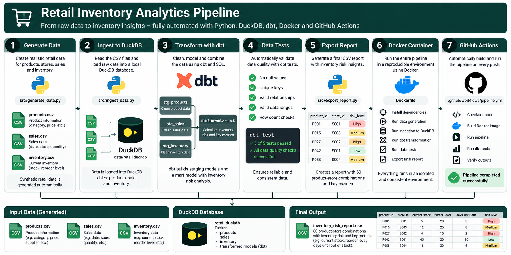

# Retail Inventory Analytics

An end-to-end retail inventory analytics pipeline built with Python, DuckDB, dbt and Docker.

## Business Problem

Retailers need to identify products at risk of running out of stock before replenishment arrives.

This project analyzes sales velocity, current inventory and supplier lead times to classify inventory risks across multiple stores.

## Tech Stack

- Python – Synthetic data generation and ingestion
- DuckDB – Analytical database
- SQL & dbt – Data transformation and testing
- Docker – Reproducible execution
- GitHub Actions – Automated pipeline validation

## Architecture
The diagram below illustrates the end-to-end data pipeline, from synthetic data generation to automated validation and reporting.



## Dataset

The project uses reproducible synthetic retail data:

- 3 stores
- 20 products
- 1,628 sales transactions
- 60 inventory records

No real customer or company data is used.

## Inventory Risk Logic

Days of Cover = Current Stock / Average Daily Sales

Products are classified into:

- OUT_OF_STOCK – No inventory remaining
- HIGH – Stock coverage is below supplier lead time
- MEDIUM – Stock coverage is within 3 days above lead time
- LOW – Sufficient stock coverage
- NO_SALES – No recorded sales during the analysis period

The thresholds are illustrative business rules, not validated production policies.

## Run with Docker

```bash
docker build -t retail-inventory-analytics .
docker run --rm retail-inventory-analytics
```

## Run Locally

Install the dependencies:

```bash
pip install -r requirements.txt
```

Then execute:

```bash
python run_pipeline.py
```

## Data Quality

dbt validates product IDs, transaction IDs and inventory risk classifications.

The pipeline includes 5 automated data tests.

## Output

The pipeline generates:

`reports/inventory_risk.csv`

The report contains inventory risk assessments for 60 store-product combinations.

When running inside Docker, the report is stored in the container unless an output volume is mounted.

## Limitations

- Synthetic data only
- Simplified demand calculations based on a 30-day sales window
- No seasonality, promotions or demand forecasting
- Fixed illustrative risk thresholds

## Future Improvements

- Demand forecasting
- Automated replenishment recommendations
- Integration with real retail APIs
